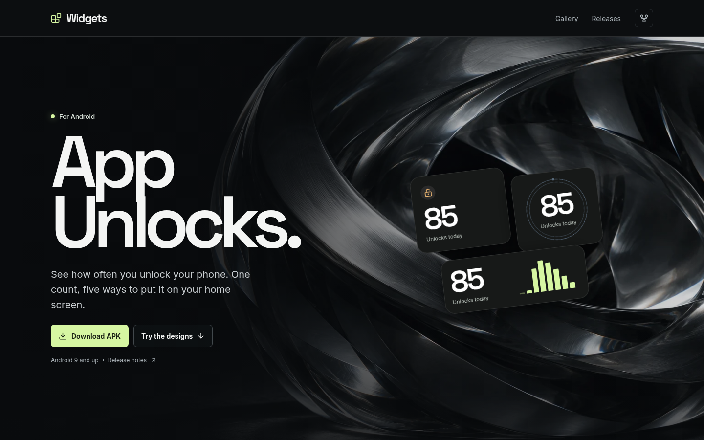

# Widgets

For some reason I've gotten really into making widgets lately. They were a big part of why I liked my Nothing Phone, and that carried over into the stuff I build. [Task-tick](https://github.com/wrestle-R/Task-tick) and [Pingora](https://github.com/wrestle-R/Pingora) already have a bunch of them. [TickTick](https://ticktick.com/) has some really good widgets too. I use them to see what's coming up at a glance.

App Unlocks counts how often I unlock my phone. It’s one Android widget with five designs. You can [try them at different sizes and download the app](https://widgets-gules-nu.vercel.app/).

Got an idea? [Open an issue](https://github.com/wrestle-R/widgets/issues/new?template=widget-idea.yml) with a screenshot or a wall of text. I'll see what I can turn into a widget. Pull requests are welcome too.
